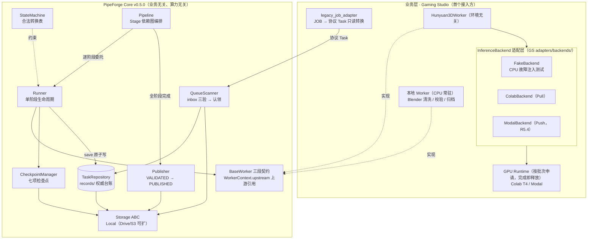

[](https://www.python.org/)
[](LICENSE)
[](CHANGELOG.md)
[](tests/_run_all.py)

# PipeForge

> 面向 AI 生成与数据处理场景的**可恢复生产管线框架**：统一任务协议、阶段状态管理、
断点恢复、Worker 执行接口、质量门禁与产物发布机制。

## 定位与边界

第一版只解决一个核心问题：**让一个生产任务从提交、执行、失败恢复，到质量验证和
产物交付，具备统一协议和可追踪性。**

它不是 AI Agent 框架、分布式工作流引擎或通用任务调度平台。

**业务无关约束**：本包不出现任何业务依赖（Hunyuan3D/Blender/Godot/游戏资产 Profile）。
框架只定义接口与执行机制，业务侧实现 Adapter 接入。

## 当前能力（0.5.0）

| 能力 | 状态 |
|---|---|
| Task / Manifest Schema（draft-07） | ✅ 已迁移 + 双形态 stages（初始空/执行后完整含 checkpoint_data） |
| protocol.py（ID/状态机/七项检查点/Hash/发布校验） | ✅ 已迁移，7 项测试全过 |
| Storage 接口 + LocalStorage（含二进制 IO） | ✅ 0.2.0 / 0.4.0 |
| TaskRepository.save 原子持久化（内存权威副本） | ✅ 0.4.0 |
| TaskRepository / StateMachine / CheckpointManager / QueueScanner | ✅ 0.2.0 |
| BaseWorker / WorkerResult / WorkerContext / Artifact | ✅ 0.3.0 |
| 通用示例 FileWorker（第二验收场景） | ✅ 0.3.0（examples/） |
| Runner 执行协调层（状态门控/幂等跳过/失败分类重试/检查点原子持久化） | ✅ 0.4.0 |
| GS 端到端验收（真实任务全链路演示） | ✅ 0.4.0（GS adapters/gs_e2e_demo.py） |
| Pipeline 多阶段编排（依赖图/拓扑序/中断恢复/上游引用） | ✅ 0.5.0 |
| Publisher 三态发布（VALIDATED→PUBLISHED/幂等/与执行隔离） | ✅ 0.5.0 |
| GS 十阶段 Mock Demo | ✅ 0.5.0（examples/gs_ten_stage_demo.py） |

## 整体架构



分层原则：**PF 管任务生命周期，GS 管 Worker 与 Backend，Provider 管算力。**
换 GPU 平台不改 PF Core；换模型不改 Pipeline；换算力供应商不改 GS 任务定义。

## 生产流程链路

```
① 提交        业务 Adapter（JOB→Task）或提交方 ──► inbox/<task>/（task.json + 引用资产 + READY）
② 认领        QueueScanner 三验（Schema + Hash + READY）──► tasks/claimed/（原子移动）
③ 编排        Pipeline 按拓扑序逐阶段委托 Runner（钻石依赖可并行；失败传播五分法）
④ 执行        Runner 单阶段：状态门控 → 幂等跳过 → validate_input → execute → validate_output
                ├─ 本地 Worker（CPU）：清洗/校验/归档
                └─ 远程 Worker（GPU）：InferenceBackend 八态生命周期
                      NOT_SUBMITTED → SUBMITTING(意图先持久化) → SUBMITTED → RUNNING
                      → REMOTE_COMPLETED → FETCHING → LOCAL_VERIFIED（唯一完成点）
⑤ 检查点      每阶段七项检查点 + 状态，单次原子写（崩溃即重入，不半写）
⑥ 发布        全阶段 COMPLETED/SKIPPED ──► Publisher：VALIDATED（逐件 Hash 复核）
                → PUBLISHED（staging 原子交换，PUBLISHED 标记最后写，幂等可重发）
⑦ 交付        library/<asset>/<version>/ + PUBLISHED ──► 游戏工程（Godot）消费

恢复语义：任意一步崩溃，重启走同一条链——COMPLETED 阶段幂等跳过（零重执行）；
远程阶段按 checkpoint.remote 八态重入（断点@SUBMITTING 幂等重放、@REMOTE_COMPLETED 只补下载）。
```

## 安装（开发期）

```bash
pip install -e .        # 基础（纯标准库，零强制依赖）
pip install -e ".[test]"  # 含 jsonschema 完整校验
```

## 快速验证

```bash
python tests/_run_all.py   # 61 tests, 0 failures（另 GS adapters 21/21 + E2E demo）
```

## 版本规则（框架版本 ≠ 协议版本）

| 对象 | 当前 | 职责 |
|---|---|---|
| PipeForge 包版本 | 0.1.0 | 框架代码兼容性 |
| Task Schema | 2.0 | 任务协议兼容性 |
| Manifest Schema | 2.0 | 产物清单兼容性 |

## 首个业务接入方

`D:\Gaming Studio\AssetFactory`（3D 美术资产生产）——通过 Adapter 接入，
Profile 与 Blender Worker 保留业务侧。

## English Summary

**PipeForge** is a recoverable production-pipeline framework for AI generation and data
processing workloads. It provides a unified task protocol, staged state management,
checkpoint-based resumption, a worker execution interface, quality gates, and artifact
publishing. It is deliberately business-agnostic: no 3D/Blender/Godot/game concepts live here;
consumers plug in via adapters. First adopter: the Gaming Studio AssetFactory pipeline.

Current status: **0.5.0** — protocol + task kernel + worker contract + Runner
(single-stage lifecycle, four-scenario consistency) + Pipeline (dependency-graph
orchestration, stage-level resume) + Publisher (three-state release). 61/61 tests.
GPU execution backends live in the first adopter's adapter layer (spec V1.0:
Pull/Push modes, 8-state remote lifecycle). See [CHANGELOG.md](CHANGELOG.md).

## 设计任务书

- [R4 多阶段编排架构设计与实施任务书 V1.0](docs/PipeForge_R4_多阶段编排架构设计与实施任务书_V1.0.md) —— Stage/Pipeline/Publisher 四契约、失败传播五分表、R4.1–R4.6 里程碑

## 开发手册

- [R1–R3 实现进度手册与踩坑修复指南](docs/R1-R3_实现进度手册与踩坑指南.md) —— 职责图、进度总览、16 项踩坑（P01–P16）、开发前检查清单

## 路线

- **R0** ✅ 独立仓库 + 协议迁移
- **R1** ✅ 任务内核：Storage ABC + LocalStorage + Repository/StateMachine/Checkpoint/QueueScanner（22 测试全绿）
- **R2** ✅ Worker 契约 + FileWorker 第二场景 + GS legacy_job_adapter（27+8 测试全绿；GS 仅新增 adapters/，零改动既有文件）
- **R3** ✅ Runner 执行协调层 + 四场景一致性 + GS 端到端验收（45/45；真实香炉任务全链绿）
- **R4** ✅ Pipeline 多阶段编排 + Publisher 三态发布（61/61；十阶段 中断@7→恢复→发布→幂等 全链）
- **R5** 🔨 GPU Backend 解耦（GS 侧 adapters/backends/）：规范 V1.0 锁定；FakeBackend 恢复矩阵 8/8；ColabBackend Pull 5/5（A4 换后端零改动）；Modal Push 与真 GPU 全链（A2/A3）待做
- **R1** 任务内核：Storage 接口 → LocalStorage → TaskRepository / StateMachine 薄封装 / CheckpointManager / QueueScanner（tempdir 测试）
- **R2** Gaming Studio 接入：BaseWorker + 香炉样本真实任务跑通 提交→执行→Checkpoint→恢复→发布